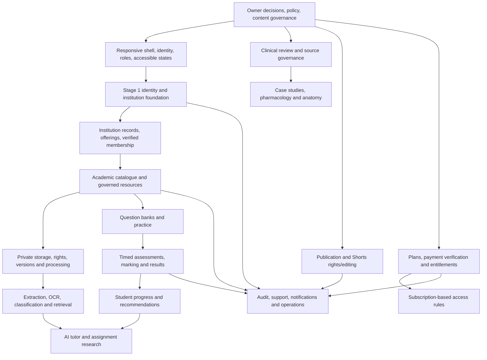

# Module Dependency Map

## Delivery order and gates

1. **Repository, shell, identity and role contracts.** Keep the original static demo usable; use independent-student flows as a first-class pathway. Verify responsive shell and role resolution.
2. **Stage 1 staging verification.** Review four migrations, deploy to staging only, and test Auth, provisioning, institutional boundaries, imports, invitations, recovery and audit. Block real institutional/student data until it passes.
3. **Academic catalogue and governed library.** Resolve official catalogue and content-rights rules. Add resource versions, ownership, audience grants and review decisions before storage publication.
4. **Private storage and knowledge processing.** Approve file formats/retention/scanning; build quarantine, upload/download authorization and processing tests before OCR or indexing.
5. **Teaching and institutional expansion.** Add academic years/intakes, lecturer assignments and class scope; cross-institution tests precede cohort analytics.
6. **Assessments and clinical modules.** Reviewed content and server-enforced attempt rules precede progress analytics or official assessment.
7. **Assignment and AI support.** Requires authorized retrieval, provider/data policy, clinical safeguards, source attribution, evaluation and cost controls.
8. **Publishing, finance and platform operations.** Rights review precedes publication; business terms and verified payment integration precede billing. Audit, support, backup and monitoring precede release.

## Integration contracts

- All UI reads/writes go through typed repositories or named Edge Functions; no privileged secret in browser code.
- Resource visibility is a combination of rights state, publication state, audience grant, account role and current institution membership.
- Official-record edits do not silently mutate linked account roles or access.
- Search, AI and analytics cannot widen access beyond source-record grants.
- Financial state and institution compliance state remain separate state machines.
- Cross-module navigation is provided now, but each skeleton remains visibly unintegrated until its contract and tests exist.
